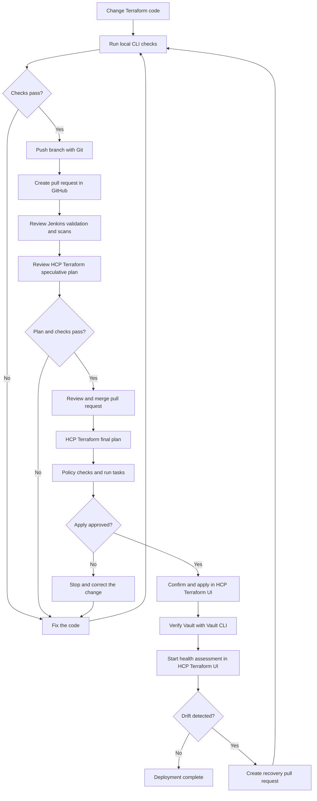
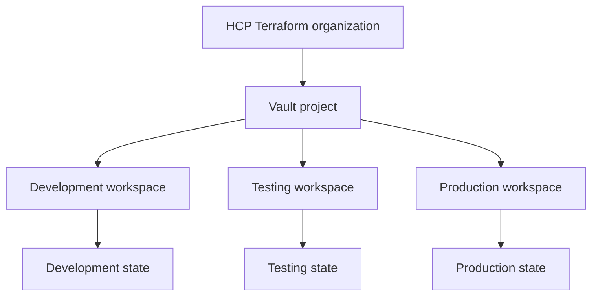

# Workshop 3: GitHub, Jenkins, HCP Terraform, Security, and Drift

<!-- markdownlint-disable MD013 MD024 MD025 -->

[Back to the workshop landing page](./README.md)

**Live delivery:** Use this file as the UI-guided presenter script and
technical reference. Use the Jenkins and HCP Terraform interfaces for setup,
review, approval, state, health, and drift. Use the terminal for code changes,
local validation, Git, and Vault verification.

## Workshop 3 timeline

| Time | Block | Topics |
| --- | --- | --- |
| 0:00-0:55 | Delivery and execution | GitHub, Jenkins, HCP Terraform workspaces, plans, approvals, Agents, and OIDC |
| 0:55-1:05 | Break | 10-minute break |
| 1:05-2:00 | Guardrails and operating model | Scanning, policy enforcement, drift, private registry, RBAC, governance, and Infragraph |

## Workshop 3 goal

### Notes!

> Today we will follow one change from GitHub to Vault.
>
> We will see where Jenkins, HCP Terraform, the Agent, OIDC credentials,
> policies, approvals, state, and drift detection fit.
>
> We will also discuss how a central platform team can provide governance
> without owning every other team's Terraform code.

## Workshop 3 delivery workflow



### Notes!

> Everything starts with a Terraform code change.
>
> We validate and scan the code before it is merged.
>
> Jenkins performs code checks. HCP Terraform creates the authoritative plan
> and performs the approved apply.
>
> We verify the result with the Vault CLI. If drift is detected, we correct it
> through another reviewed code change.

## Course repository structure

```text
terraform-ntax/
├── README.md
├── prerequisites.md
│
├── workshop-1.md
├── workshop-2.md
├── workshop-3.md
│
├── examples/
│   ├── workshop-1/
│   │   ├── provider.tf
│   │   ├── main.tf
│   │   ├── variables.tf
│   │   ├── outputs.tf
│   │   └── terraform.tfvars.example
│   │
│   ├── workshop-2/
│   │   ├── import/
│   │   │   └── main.tf
│   │   ├── moved-block/
│   │   │   └── main.tf
│   │   └── modules/
│   │       └── legacy-mount/
│   │           ├── main.tf
│   │           ├── variables.tf
│   │           └── outputs.tf
│   │
│   └── workshop-3/
│       ├── bootstrap/
│       │   ├── main.tf
│       │   ├── variables.tf
│       │   ├── outputs.tf
│       │   └── terraform.tfvars.example
│       ├── vault-configuration/
│       │   ├── main.tf
│       │   ├── variables.tf
│       │   └── outputs.tf
│       └── scripts/
│           ├── verify-vault.sh
│           ├── check-run.sh
│           └── check-drift.sh
│
├── policies/
│   ├── sentinel/
│   └── vault/
│
├── jenkins/
│   └── Jenkinsfile
│
└── modules/
    └── vault-team/
        ├── main.tf
        ├── variables.tf
        ├── outputs.tf
        └── README.md
```

### Notes!

> The root README is the landing page for all three workshops.
>
> Each workshop has its own guide and examples. Shared production modules stay
> under `modules`. Workshop-specific lab code stays under `examples`.
>
> Policies and Jenkins configuration have their own top-level directories so
> they can be reviewed and maintained separately.

## UI-guided delivery requirements

### Notes!

> We use the UI when it makes the workflow easier to understand.
>
> Jenkins shows validation and scan results. HCP Terraform shows workspaces,
> plans, policy results, approvals, state, and drift.
>
> We still use the terminal for editing Terraform, local checks, Git commands,
> and Vault CLI verification.

### Required access

- GitHub repository access
- Jenkins administrator or job-creation access
- HCP Terraform access to the `nutx` organization
- Permission to create a project and workspace
- An existing GitHub App connection in HCP Terraform
- An approved HCP Terraform Agent pool
- Vault OIDC trust, roles, policies, namespace, and CA trust
- A disposable development Vault environment

### Required local commands

```bash
terraform version
vault version
git --version
trivy --version
```

Check the local Vault connection:

```bash
export VAULT_ADDR="https://vault.example.com:8200"
export VAULT_CACERT="/path/to/vault-ca.pem"
export VAULT_NAMESPACE="nutanix"

read -r -s -p "Temporary Vault demonstration token: " VAULT_TOKEN
printf '\n'
export VAULT_TOKEN

vault status
```

### Safety note

> Do not put tokens in Git, Terraform files, screenshots, Jenkins logs, or
> normal HCP Terraform variables.
>
> The HCP Terraform run uses Vault OIDC dynamic credentials. The temporary
> `VAULT_TOKEN` is only for the controlled trainer verification and drift
> demonstration.

## Part 1: Definition

### GitHub

### Notes!

> GitHub stores the Terraform code and JSON configuration. A pull request gives
> the team a place to review the code before merging it.

### Jenkins

### Notes!

> Jenkins runs automated checks. It can check formatting, validate Terraform,
> run tests, and run a security scanner such as Trivy, Checkov, or Cycode.
>
> Jenkins checks the code. HCP Terraform still creates the authoritative plan
> and performs the approved apply.

### HCP Terraform

### Notes!

> HCP Terraform runs Terraform, stores state, connects to GitHub, shows plans,
> applies approved changes, enforces policies, and keeps run history.

### Speculative plan

### Notes!

> A speculative plan is a preview for a pull request. It helps reviewers see
> the expected infrastructure change before the code is merged.
>
> A speculative plan cannot be applied.

### HCP Terraform Agent

### Notes!

> The Agent runs Terraform inside the private network. It allows HCP Terraform
> to reach a private Vault API without making Vault public.
>
> The Agent is not the Vault credential.

### OIDC dynamic credentials

### Notes!

> OIDC lets an HCP Terraform run authenticate to Vault with short-lived
> credentials.
>
> This is safer than storing a permanent Vault token in Git or in a normal
> workspace variable.

### Policies, run tasks, and Vault EGP

### Notes!

> These controls work at different layers.
>
> A static scanner reads the Terraform code. A run task calls an external
> service during an HCP Terraform run. A Terraform policy checks the plan and
> run information. Vault EGP or RGP checks requests at the Vault API.
>
> These controls support each other. They are not replacements for each other.

### Drift detection

### Notes!

> Drift happens when the real Vault configuration changes outside the approved
> Terraform workflow.
>
> HCP Terraform health assessments can detect supported configuration drift.
> They do not automatically fix the drift.

## Part 2: Trainer hands-on walkthrough

## Step 1: Show the repository layout

### In terminal

```text
terraform-ntax/
|-- workshop-3.md
|-- examples/
|   `-- workshop-3/
|       |-- bootstrap/
|       `-- vault-configuration/
|           |-- main.tf
|           |-- variables.tf
|           `-- outputs.tf
|-- jenkins/
|   `-- Jenkinsfile
|-- policies/
|   |-- sentinel/
|   `-- vault/
`-- modules/
    `-- vault-team/
```

### Notes!

> Workshop-specific configuration stays under `examples/workshop-3`.
>
> The reusable Vault module stays under `modules/vault-team`.
>
> Jenkins reads `jenkins/Jenkinsfile`. HCP Terraform runs from
> `examples/workshop-3/vault-configuration`.
>
> Development and production must use separate workspaces, state, access, and
> approvals.

## Step 2: Create the Jenkins validation pipeline

### In Jenkins

1. From the Jenkins dashboard, select **New Item** or **Create a job**.
2. Enter `vault-platform`.
3. Select **Multibranch Pipeline**, then select **OK**.
4. Under **Branch Sources**, add **GitHub** or **Git**.
5. Select the approved GitHub credential.
6. Enter the repository containing `terraform-ntax`.
7. Configure branch and pull-request discovery.
8. Under **Build Configuration**, select **by Jenkinsfile**.
9. Set **Script Path** to `jenkins/Jenkinsfile`.
10. Save the job.
11. Select **Scan Multibranch Pipeline Now**.
12. Open a branch build, then select **Console Output**.

### In the repository

```groovy
pipeline {
  agent any

  stages {
    stage('Terraform format') {
      steps {
        sh 'terraform fmt -check -recursive'
      }
    }

    stage('Terraform validate') {
      steps {
        sh 'terraform -chdir=examples/workshop-3/vault-configuration init -backend=false'
        sh 'terraform -chdir=examples/workshop-3/vault-configuration validate'
      }
    }

    stage('Terraform security scan') {
      steps {
        sh 'trivy config --exit-code 1 --severity HIGH,CRITICAL .'
      }
    }
  }
}
```

### Notes!

> The Jenkins agent must already have Git, Terraform, and Trivy installed.
>
> Jenkins checks formatting, validates the Terraform configuration, and scans
> the code.
>
> Jenkins does not apply the Vault configuration. HCP Terraform owns the
> authoritative plan and apply.
>
> Store the pipeline in Git. Do not paste a long production pipeline directly
> into the Jenkins job configuration.

## Step 3: Create the development workspace in HCP Terraform

### HCP Terraform project, workspace, and state hierarchy



### In HCP Terraform

Create the project:

1. Select the `nutx` organization.
2. Select **Projects**.
3. Create a project named `Vault Development`.

Create the workspace:

1. Select **Workspaces**, then **New Workspace**.
2. Select **Version control workflow**.
3. Select the approved GitHub App connection.
4. Select the `terraform-ntax` repository.
5. Select the `Vault Development` project.
6. Name the workspace `vault-team-pilot-dev`.
7. Open **Advanced options**.
8. Set the branch to `main`.
9. Set the Terraform working directory to
   `examples/workshop-3/vault-configuration`.
10. Configure automatic run triggering for:
    - `examples/workshop-3/vault-configuration/**`
    - `modules/**`
11. Keep **Auto apply** disabled.
12. Create the workspace.

Configure execution:

1. Open the workspace.
2. Select **Settings**, then **General**.
3. Set **Execution Mode** to **Agent**.
4. Select the approved Agent pool.
5. Save the settings.

### Notes!

> We use the Version control workflow because the repository is the source of
> truth. Pull requests receive speculative plans and merged changes trigger
> normal workspace runs.
>
> The workspace owns only the development pilot and its state.
>
> The project groups related workspaces and access. It does not contain one
> shared state file.
>
> One Vault resource must have only one owning workspace and one state file.
>
> Auto apply stays disabled so an authorized person reviews the final plan
> before applying it.
>
> After the pilot is proven, the platform team can codify this workspace setup
> with the HCP Terraform provider.

## Step 4: Configure Vault dynamic credentials

### In HCP Terraform

Open `vault-team-pilot-dev`, then open **Variables**.

Add these environment variables:

| Key | Example value | Sensitive |
| --- | --- | --- |
| `TFC_VAULT_PROVIDER_AUTH` | `true` | No |
| `TFC_VAULT_ADDR` | `https://vault.example.com:8200` | No |
| `TFC_VAULT_RUN_ROLE` | `vault-team-pilot` | No |
| `TFC_VAULT_NAMESPACE` | `nutanix` | No |

If plan and apply require different Vault permissions, use these instead of
`TFC_VAULT_RUN_ROLE`:

| Key | Example value |
| --- | --- |
| `TFC_VAULT_PLAN_ROLE` | `vault-team-pilot-plan` |
| `TFC_VAULT_APPLY_ROLE` | `vault-team-pilot-apply` |

Do not add `VAULT_TOKEN` to the workspace.

### In the Terraform configuration

```hcl
provider "vault" {}
```

### Notes!

> The Agent provides private network access to Vault.
>
> OIDC provides short-lived Vault authentication.
>
> These are different responsibilities. The Agent is not a Vault credential.
>
> A Vault specialist must configure the trusted OIDC issuer, audience, bound
> claims, Vault roles, policies, token lifetime, namespace, and CA trust.
>
> The Terraform configuration does not contain a permanent Vault token.

## Step 5: Follow one GitHub change

### Notes!

> We will follow one safe development change through GitHub, Jenkins, HCP
> Terraform, and Vault.

### Establish the workspace baseline

A new VCS workspace needs one successful initial run before it processes later
VCS webhooks.

1. Open `vault-team-pilot-dev` in HCP Terraform.
2. Select **New run**.
3. Select **Plan and apply**.
4. Review the complete plan.
5. Confirm that no unexpected replacement or destruction is present.
6. Select **Confirm & Apply**.
7. Wait for the apply to finish successfully.

### In terminal

Create a branch and edit one non-sensitive description in the development
configuration:

```bash
BRANCH="workshop3-ui-change"
git switch -c "$BRANCH"

${EDITOR:-vi} examples/workshop-3/vault-configuration/main.tf

terraform fmt -check -recursive
terraform -chdir=examples/workshop-3/vault-configuration init -backend=false
terraform -chdir=examples/workshop-3/vault-configuration validate
trivy config --exit-code 1 --severity HIGH,CRITICAL .

git diff --check
git diff
git add examples/workshop-3/vault-configuration/main.tf
git commit -m "Update pilot Vault configuration"
git push --set-upstream origin "$BRANCH"
```

### In GitHub

1. Open the `terraform-ntax` repository.
2. Create a pull request from `workshop3-ui-change` into `main`.
3. Review the changed Terraform code.
4. Wait for the Jenkins and HCP Terraform checks.
5. Open the Jenkins check and confirm all stages passed.
6. Open the HCP Terraform speculative plan.
7. Confirm that the speculative plan contains only the expected change.
8. Obtain peer approval.
9. Merge the pull request.

### In Jenkins

1. Open the `vault-platform` multibranch pipeline.
2. Open the pull-request branch build.
3. Review **Stage View** or **Console Output**.
4. Confirm formatting, validation, and security scanning passed.

### In HCP Terraform before merge

1. Open the speculative run connected to the pull request.
2. Review the plan summary and full plan.
3. Review policy evaluations and run-task results.
4. Confirm that this run is plan-only and cannot be applied.

### In HCP Terraform after merge

1. Open `vault-team-pilot-dev`.
2. Open the new run triggered by the merge to `main`.
3. Review the final plan again.
4. Review policy evaluations and run-task results.
5. Confirm that no unexpected deletion or replacement exists.
6. Select **Confirm & Apply**.
7. Wait for the apply to complete.
8. Review the run history and current state summary.

### Verify Vault

```bash
vault secrets list -namespace="$VAULT_NAMESPACE"
```

After the first successful apply, enable health assessments:

1. Open the workspace.
2. Select **Settings**, then **Health**.
3. Select **Enable**.
4. Save the settings.

### Notes!

> GitHub provides code review.
>
> Jenkins provides automated code checks.
>
> The speculative plan previews the infrastructure change before merge.
>
> The final HCP Terraform run performs policy checks, waits for approval,
> executes through the Agent, and uses short-lived Vault credentials.
>
> HCP Terraform stores the updated state and run history.

## Step 6: Show the security layers

### Security control map

| Control | What it checks |
| --- | --- |
| `terraform fmt` and `validate` | Formatting and Terraform validity |
| Trivy, Checkov, or Cycode | Static security scan of Terraform code |
| HCP Terraform run task | External service result during a run |
| Sentinel, OPA, or Terraform policy | Terraform plan and run information |
| Vault EGP or RGP | Vault API requests |
| Health assessment | Drift after deployment |

### Notes!

> Formatting and validation find basic code problems.
>
> Trivy, Checkov, or Cycode scans the Terraform code for security risks.
>
> A run task sends run information to an external service.
>
> Sentinel, OPA, or another supported HCP Terraform policy checks the plan and
> its metadata.
>
> Vault EGP or RGP protects Vault at request time, even when the request comes
> from another approved client.
>
> A health assessment checks for drift after deployment.

## Step 7: Demonstrate drift detection

### Notes!

> I will make one controlled change directly in development Vault. This
> represents a change made outside the approved Terraform workflow.

### In terminal

Use only a disposable development mount:

```bash
export DRIFT_DEMO_MOUNT="team-kv"

ORIGINAL_DESCRIPTION="$(
  vault secrets list \
    -namespace="$VAULT_NAMESPACE" \
    -format=json |
    jq -r --arg mount "$DRIFT_DEMO_MOUNT/" '.[$mount].description'
)"

printf 'Original description: %s\n' "$ORIGINAL_DESCRIPTION"

vault secrets tune \
  -namespace="$VAULT_NAMESPACE" \
  -description="OUT-OF-BAND DRIFT DEMONSTRATION" \
  "$DRIFT_DEMO_MOUNT/"
```

### In HCP Terraform

1. Open `vault-team-pilot-dev`.
2. Open **Health**.
3. Select **Start health assessment**.
4. Wait for the assessment to finish.
5. Open **Drift** or **View details**.
6. Show the resource and attribute that changed.
7. Confirm that the assessment detected the change but did not modify Vault.

### Resolve the drift

Choose one response:

**Reject the manual change**

1. Select **New run**.
2. Select **Plan and apply**.
3. Confirm that the plan restores the Git-defined value.
4. Select **Confirm & Apply**.
5. Start another health assessment and confirm that the workspace is healthy.

**Accept the manual change**

1. Update the Terraform configuration to match the approved value.
2. Create a pull request.
3. Pass Jenkins and the speculative plan.
4. Merge the approved change.
5. Apply the final HCP Terraform run.

### Notes!

> Drift detection reports that the real Vault configuration no longer matches
> the Terraform configuration. It does not automatically repair the change.
>
> We either restore the value defined in Git or update Git through the normal
> review process.
>
> We do not hide unexplained drift by editing Terraform state manually.

## Step 8: Show the shared governance model

### Responsibility map

| Central platform team owns | Consumer team owns |
| --- | --- |
| Approved modules | Environment inputs |
| Module versions and retirement | Pull requests |
| Workspace standards | Workspace runs within its access |
| Policy sets and exceptions | Deployment results |
| Identity and access standards | Failed plan and drift remediation |
| Agent and credential patterns | Daily use of the approved pattern |
| Audit and governance visibility | Its infrastructure responsibility |

### Notes!

> The central team should not own every other team's Terraform code and every
> apply.
>
> The central team provides approved modules, workspace standards, policies,
> access rules, Agent patterns, and secure credential patterns.
>
> Consumer teams keep ownership of their configuration, pull requests,
> deployments, and problems.
>
> We start new policies in advisory mode. We check failures and false positives.
> We create an exception process. After the policy is stable, we can make it
> mandatory.

## Step 9: Separate HCP Terraform access from Vault access

### Notes!

> We have two permission layers.
>
> HCP Terraform permissions control who can view, plan, apply, approve, and
> manage projects and workspaces.
>
> Vault permissions control what Terraform can create or change inside Vault.
> This includes Vault namespaces, ACL policies, and EGP or RGP policies.
>
> We need both layers. HCP Terraform access does not replace Vault access.

## Step 10: Publish the private module

### In terminal

Validate, scan, commit, and tag the module:

```bash
terraform fmt -check -recursive
terraform -chdir=modules/vault-team init -backend=false
terraform -chdir=modules/vault-team validate
trivy config --exit-code 1 --severity HIGH,CRITICAL modules/vault-team

git status --short
git tag -a v1.0.0 -m "Release vault-team module v1.0.0"
git push origin v1.0.0
```

### In HCP Terraform

1. Select **Registry**.
2. Select **Publish**, then **Module**.
3. Select the approved GitHub VCS connection.
4. Select the `terraform-ntax` repository.
5. Select tag-based publishing.
6. Set **Source Directory** to `modules/vault-team`.
7. Leave the tag prefix empty when using tags such as `v1.0.0`.
8. Select **Publish module**.
9. Review the generated documentation, inputs, outputs, and available version.
10. Copy the module usage example.

Pin the module version in consuming code:

```hcl
module "vault_team" {
  source  = "app.terraform.io/nutx/vault-team/vault"
  version = "1.0.0"

  # Approved inputs
}
```

### Notes!

> The private registry gives Nutanix control over internal module publishing
> and discovery.
>
> Private does not automatically mean secure. Every module still needs review,
> tests, scanning, versioning, documentation, and maintenance.
>
> Consumers pin an approved version. New module changes require a new reviewed
> release.

## Step 11: Show Explorer and Infragraph

### HCP Terraform Explorer

1. Select **Explorer** from the HCP Terraform organization sidebar.
2. Open **Workspaces**.
3. Show **Drifted workspaces**.
4. Show workspaces without a VCS connection.
5. Show Terraform, provider, and module version visibility.
6. Open `vault-team-pilot-dev` from the results.

### Infragraph Graph Explorer

Use this section only when Infragraph is already activated and connected.

1. Open the HCP organization.
2. Select **Graph explorer**.
3. Select **Add resource type**.
4. Choose an available HCP Terraform or infrastructure resource type.
5. Add a relationship or filter.
6. Run the query.
7. Switch between graph and table views.
8. Select a resource to inspect its details and relationships.

### Notes!

> HCP Terraform Explorer summarizes workspace, run, version, module, provider,
> and health information across the organization.
>
> Infragraph shows supported infrastructure resources and their relationships.
>
> They do not replace Terraform state, policy enforcement, security scanning,
> or drift remediation.
>
> Infragraph data is synchronized. It is not a real-time control plane and it
> does not automatically fix infrastructure.

## Part 3: Attendee hands-on practice

## Practice 1: Put the workflow in order

### Notes!

> Put these steps in the correct order: GitHub pull request, Jenkins checks,
> speculative plan, peer review and merge, HCP Terraform workspace plan,
> approval, Agent execution with OIDC, and state update with health assessment.

### Answer

1. GitHub pull request
2. Jenkins checks
3. HCP Terraform speculative plan
4. Peer review and merge
5. HCP Terraform workspace plan
6. Authorized approval
7. Agent execution with OIDC
8. State update and health assessment

## Practice 2: Choose the correct control

### Notes!

> Match each requirement with its main control.

| Requirement | Correct control |
| --- | --- |
| Check Terraform syntax | `terraform validate` |
| Scan Terraform code | Trivy, Checkov, or Cycode |
| Require an approved module | Sentinel, OPA, or HCP Terraform policy |
| Restrict a Vault API operation | Vault EGP or RGP |
| Reach private Vault | HCP Terraform Agent |
| Authenticate without a permanent token | OIDC dynamic credentials |
| Find a manual change | Health assessment |

## Practice 3: Choose Terraform or an operational job

### Notes!

> Decide whether each activity belongs in Terraform desired state or in a
> separate operational job.

| Activity | Correct answer |
| --- | --- |
| Ensure a namespace exists | Terraform |
| Define an ACL policy | Terraform |
| Configure a secrets engine | Terraform |
| Delete inactive identities on a schedule | Operational job |
| Run Vault upgrade tests | Operational job |
| Perform a one-time data migration | Operational job |

### Notes!

> Terraform is good for describing what should exist.
>
> It should not become a general scheduler for cleanup, runtime decisions,
> upgrade tests, emergency actions, or one-time migrations.

## Part 4: Quiz

### Notes!

> We will finish with five short questions. Choose the best answer.

1. What starts a speculative plan?
   - A. A change in a connected pull request
   - B. Vault token expiration
   - C. State deletion
   - D. An Infragraph query
2. What does the Agent provide?
   - A. A permanent Vault token
   - B. Private execution and network access
   - C. GitHub approval
   - D. Vault policy code
3. What gives the run short-lived Vault authentication?
   - A. OIDC dynamic credentials
   - B. Jenkins logs
   - C. Infragraph
   - D. A moved block
4. What does a health assessment do?
   - A. Detects drift and check failures
   - B. Fixes every manual change automatically
   - C. Creates a Vault cluster
   - D. Publishes a module
5. Who owns a consumer team's deployment?
   - A. The consumer team within central guardrails
   - B. The central team in every case
   - C. The scanner vendor
   - D. The Vault root token owner

### Answer key

1. A
2. B
3. A
4. A
5. A

## Workshop 3 closing notes

### Notes!

> We now have a complete target pattern.
>
> GitHub stores and reviews the code. Jenkins checks the code. HCP Terraform
> creates the plan, enforces policies, controls approval, runs Terraform, stores
> state, and detects drift.
>
> The Agent provides private network access. OIDC provides short-lived Vault
> authentication.
>
> The next step is not a large production rollout. The next step is one
> development pilot. We will prove the pattern, record what we learn, and then
> decide how to expand it.

---

## After the Training

## Development pilot

### Notes!

> The first pilot will use one new or existing development team namespace.
>
> We will list the exact Vault resources in scope. We will build and review the
> module. We will create the development JSON configuration. We will add
> Jenkins checks and connect the development HCP Terraform workspace to GitHub.
>
> We will configure Agent connectivity and short-lived Vault authentication.
> If the resources already exist, we will import one resource type at a time.
>
> We will review every plan before apply. After the first successful apply, we
> will create one controlled drift event and confirm that the team can detect
> and respond to it.

## Pilot checklist

- [ ] Select one development team or namespace.
- [ ] List the Vault resources in scope.
- [ ] Confirm the final Terraform resource addresses.
- [ ] Build the reusable module.
- [ ] Create the non-sensitive JSON input.
- [ ] Add Jenkins validation and scanning.
- [ ] Connect the development workspace to GitHub.
- [ ] Disable auto-apply.
- [ ] Configure the Agent pool.
- [ ] Configure Vault OIDC credentials.
- [ ] Add the required policies and run tasks.
- [ ] Import existing resources one type at a time, if needed.
- [ ] Review every first plan.
- [ ] Apply only after approval.
- [ ] Create and detect one controlled drift event.
- [ ] Record lessons before expanding.

## Pilot success

### Notes!

> The pilot succeeds when one engineer can add or manage the pilot team through
> reviewed configuration, the module creates consistent resources, and the
> workspace manages only the intended development resources.
>
> Jenkins checks must pass. HCP Terraform policies and approvals must work. The
> Agent must reach Vault without making Vault public. HCP Terraform must use
> short-lived Vault credentials. State must stay protected in HCP Terraform.
>
> The team must also detect one controlled drift event and know how to respond.

## Safety notes for you

Do not read this section to the customer. Use it to protect the demonstration.

- Do not say every Terraform resource supports import.
- Do not say import guarantees a clean plan.
- Do not say a data source imports a resource.
- Do not say a module knows the existing infrastructure.
- Do not call the Agent a Vault credential.
- Do not say run tasks promote development to production.
- Do not say Infragraph fixes drift.
- Do not say Harbor automatically scans Terraform code.
- Do not put every namespace in one state file.
- Do not use Terraform for every Vault operational task.
- Do not use a production Vault token or production workspace.

If you do not know a Vault security answer, read this:

> I need to confirm that with the Vault specialist. I do not want to guess about
> a security-sensitive configuration.

## Official references

- [Create HCP Terraform workspaces](https://developer.hashicorp.com/terraform/cloud-docs/workspaces/create)
- [HCP Terraform UI and VCS run workflow](https://developer.hashicorp.com/terraform/cloud-docs/workspaces/run/ui)
- [HCP Terraform workspace settings](https://developer.hashicorp.com/terraform/cloud-docs/workspaces/settings)
- [Configure workspace VCS connections](https://developer.hashicorp.com/terraform/cloud-docs/workspaces/settings/vcs)
- [HCP Terraform Vault dynamic credentials](https://developer.hashicorp.com/terraform/cloud-docs/dynamic-provider-credentials/vault-configuration)
- [HCP Terraform health assessments](https://developer.hashicorp.com/terraform/cloud-docs/workspaces/health)
- [HCP Terraform run tasks](https://developer.hashicorp.com/terraform/cloud-docs/workspaces/settings/run-tasks)
- [View policy enforcement results](https://developer.hashicorp.com/terraform/cloud-docs/workspaces/policy-enforcement/view-results)
- [Publish private modules](https://developer.hashicorp.com/terraform/cloud-docs/registry/publish-modules)
- [HCP Terraform Explorer](https://developer.hashicorp.com/terraform/cloud-docs/workspaces/explorer)
- [Infragraph Graph Explorer](https://developer.hashicorp.com/hcp/docs/infragraph/view/explorer)
- [Jenkins Pipeline from source control](https://www.jenkins.io/doc/book/pipeline/getting-started/)
- [Vault Terraform provider tutorial](https://developer.hashicorp.com/vault/tutorials/get-started/learn-terraform)
- [Manage Vault with Terraform](https://developer.hashicorp.com/vault/docs/configuration/programmatic-management)
- [HCP Terraform project best practices](https://developer.hashicorp.com/terraform/cloud-docs/projects/best-practices)

## Navigation

- Previous: [Workshop 2: Import, Moved Blocks, Workspaces, and State](./workshop-2.md)
- Landing page: [Nutanix Terraform and Vault Workshop Series](./README.md)
