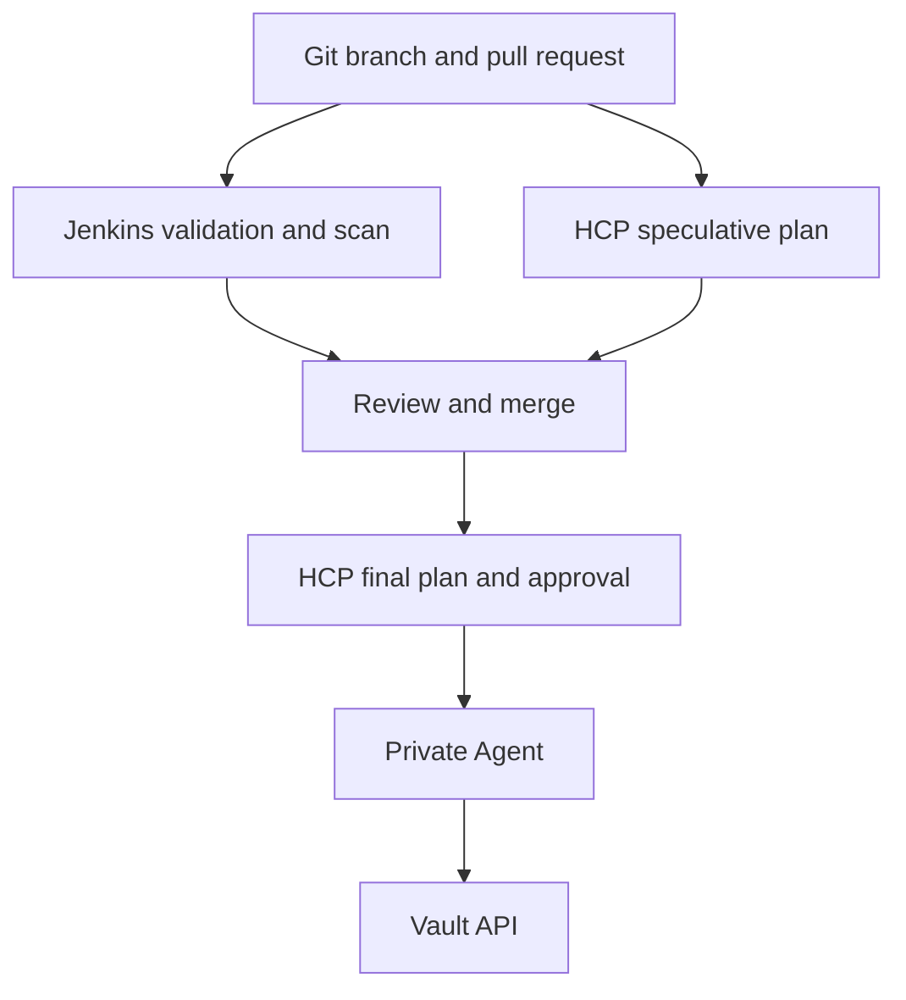

# Workshop 3 Replica Lab

## GitHub, Jenkins, HCP Terraform, Vault OIDC, and Drift Detection

This is a clean duplicate of the Workshop 3 lab.

It uses new names so it does not collide with the first lab.

Use this guide from top to bottom during the workshop.

> Speaker note
>
> Today we will move one Vault change from Git to Jenkins, through HCP Terraform, and into Vault.
>
> Jenkins will validate and scan the code. HCP Terraform will own the authoritative plan, state, approval, and apply.

## What the lab creates

| Item | New name |
| --- | --- |
| HCP Terraform organization | `ray-ntnx-vault-replica` |
| HCP Terraform project | `Replica Secrets Lab` |
| HCP Terraform workspace | `vault-replica-dev` |
| Git branch | `replica-vault-delivery` |
| Terraform working directory | `training-evidence/workshop-3-replica/vault-control` |
| Jenkinsfile | `jenkins/Jenkinsfile.workshop3-replica` |
| Jenkins job | `replica-vault-ci` |
| HCP Terraform Agent pool | `replica-private-runners` |
| HCP Terraform Agent | `replica-mac-runner` |
| Podman Agent container | `hcp-agent-replica` |
| Vault JWT auth path | `replica-oidc` |
| Vault policy | `replica-vault-admin` |
| Vault JWT role | `replica-hcp-role` |
| Terraform resource address | `vault_mount.replica_store` |
| Vault KV mount | `session-two-kv` |
| Terraform output | `replica_store_path` |

Important: HCP Terraform organization names must be unique. If `ray-ntnx-vault-replica` is unavailable, append a unique suffix. You must use that exact final name in the Vault JWT role.

This guide assumes the new organization has HCP Terraform Agent access. Confirm the **Agents** page is available before configuring Vault. If it is unavailable, use a new project and workspace inside the existing Agent-enabled organization, then replace `ray-ntnx-vault-replica` everywhere in this guide and in the Vault JWT role. Do not mix organization names.

## Product-defined names that cannot be renamed

These keys are defined by HCP Terraform. Keep them exactly as written:

```text
TFC_AGENT_TOKEN
TFC_AGENT_NAME
TFC_VAULT_PROVIDER_AUTH
TFC_VAULT_ADDR
TFC_VAULT_RUN_ROLE
TFC_VAULT_AUTH_PATH
```

The values assigned to those keys are new for this replica lab.

## Dependencies intentionally reused

| Dependency | Reused value | Reason |
| --- | --- | --- |
| GitHub repository | `therayy/terraform-ntax` | The replica uses a new branch, file path, and Jenkinsfile inside the same training repository |
| Local Vault endpoint | `http://127.0.0.1:8200` | The replica uses a new auth path, policy, role, and KV mount on the same disposable server |
| Jenkins controller | Existing local Jenkins | The replica creates a separate Multibranch Pipeline job |

Everything created by this lab has a new name. Only these shared training dependencies are reused.

## Workshop timeline

| Time | Activity | Outcome |
| --- | --- | --- |
| 0:00-0:10 | Explain the workflow and names | Everyone understands tool ownership |
| 0:10-0:30 | Create Terraform and Jenkins files | New code is ready locally |
| 0:30-0:45 | Run local checks | Formatting, validation, and scanning pass |
| 0:45-1:00 | Configure Vault JWT trust | HCP Terraform can request short-lived Vault access |
| 1:00-1:10 | Break | 10-minute break |
| 1:10-1:25 | Create the Agent pool and Agent | Private Vault connectivity is ready |
| 1:25-1:40 | Create the HCP Terraform workspace | VCS, variables, and execution mode are ready |
| 1:40-1:50 | Create the Jenkins job and pull request | Both checks run on the branch |
| 1:50-2:00 | Apply, verify, and demonstrate drift | Vault is managed and drift is visible |

## Architecture



> Speaker note
>
> Git stores the desired configuration. Jenkins checks the code. HCP Terraform plans and applies it. The Agent provides network access to Vault. OIDC provides authentication to Vault.

## Repository tree

```text
terraform-ntax/
|-- jenkins/
|   `-- Jenkinsfile.workshop3-replica
`-- training-evidence/
    `-- workshop-3-replica/
        `-- vault-control/
            |-- main.tf
            `-- .terraform.lock.hcl
```

## Safety rules

1. Do not commit a Vault token, HCP Terraform Agent token, `.env` file, state file, or plan file.
2. Do not add `VAULT_TOKEN` to HCP Terraform workspace variables.
3. Add all `TFC_VAULT_*` values as Environment variables, not Terraform variables.
4. Jenkins must not run `terraform plan` against Vault or run `terraform apply`.
5. HCP Terraform is the only system allowed to perform the authoritative plan and apply.
6. Keep auto apply disabled.
7. Use this only with the disposable development Vault server.

> Speaker note
>
> We are separating code checks from infrastructure execution. That gives us one state owner and one controlled apply path.

## Preflight checklist

Run:

```bash
git --version
terraform version
trivy --version
vault version
podman version
```

Confirm before the workshop:

- [ ] Git, Terraform, Trivy, Vault CLI, and Podman run successfully.
- [ ] Jenkins is available and can execute local shell commands.
- [ ] The GitHub repository `therayy/terraform-ntax` is reachable.
- [ ] The local Vault development server is available on port `8200`.
- [ ] The HCP Terraform account can create organizations, projects, workspaces, and Agent pools.
- [ ] The HCP Terraform plan supports Agents.
- [ ] The plan supports health assessments, or you will use the normal-plan drift fallback.

If a command is missing on macOS, install only the missing tool:

```bash
brew install git
brew tap hashicorp/tap
brew install hashicorp/tap/terraform
brew install hashicorp/tap/vault
brew install trivy
brew install podman
```

Do not spend the workshop installing tools. Complete this check before the session.

---

# Part 1: Prepare the local environment

## Step 1: Open the repository

Run:

```bash
cd /Users/ray/terraform-ntax
git status
git switch main
git pull --ff-only
```

Expected result:

- You are in `terraform-ntax`.
- The current branch is `main`.
- The working tree has no unexpected changes.

Do not discard local changes that you do not recognize.

> Speaker note
>
> I am starting from the current main branch. I want the replica lab to be independent from the files used in the first run.

## Step 2: Confirm Vault is running

Use the host address from your local terminal:

```bash
export VAULT_ADDR="http://127.0.0.1:8200"
unset VAULT_CACERT
vault status
```

Expected result:

```text
Initialized     true
Sealed          false
```

If Vault is not responding, stop here. The rest of the lab will fail.

### Enter the development token without saving it

For macOS `zsh`:

```bash
read -s "VAULT_TOKEN?Enter the development Vault token: "
export VAULT_TOKEN
echo
vault token lookup
```

Do not place the token in a file. Do not commit it.

> Speaker note
>
> This root token is only for bootstrapping the disposable development server. HCP Terraform will not use this token. It will use a short-lived OIDC credential.

## Step 3: Create the new branch and directories

Run:

```bash
git switch -c replica-vault-delivery

mkdir -p training-evidence/workshop-3-replica/vault-control
mkdir -p jenkins
```

Expected branch:

```text
replica-vault-delivery
```

---

# Part 2: Create the Terraform configuration

## Step 4: Create `main.tf`

Create this file:

```text
training-evidence/workshop-3-replica/vault-control/main.tf
```

Use this content:

```hcl
terraform {
  required_version = ">= 1.5.0"

  required_providers {
    vault = {
      source  = "hashicorp/vault"
      version = "~> 5.0"
    }
  }
}

provider "vault" {}

variable "replica_prefix" {
  description = "Unique prefix for the replica workshop resources"
  type        = string
  default     = "session-two"

  validation {
    condition     = can(regex("^[a-z0-9-]+$", var.replica_prefix))
    error_message = "replica_prefix may contain only lowercase letters, numbers, and hyphens."
  }
}

resource "vault_mount" "replica_store" {
  path        = "${var.replica_prefix}-kv"
  type        = "kv"
  description = "Replica workshop KV managed through HCP Terraform"

  options = {
    version = "2"
  }

  lifecycle {
    prevent_destroy = true
  }
}

output "replica_store_path" {
  description = "Path of the replica KV version 2 secrets engine"
  value       = vault_mount.replica_store.path
}
```

### What this code does

| Block | Purpose |
| --- | --- |
| `required_providers` | Downloads the HashiCorp Vault provider |
| `provider "vault" {}` | Uses the Vault settings injected by HCP Terraform |
| `replica_prefix` | Creates a unique lab name and validates it |
| `vault_mount.replica_store` | Enables a KV version 2 secrets engine |
| `prevent_destroy` | Blocks an accidental destroy or replacement |
| `replica_store_path` | Displays the created mount path |

Do not add `address`, `token`, or `namespace` to the provider block. HCP Terraform supplies the authentication data for the run.

> Speaker note
>
> The code declares one Vault resource. The provider connects Terraform to Vault. The resource tells Terraform to enable a KV version 2 secrets engine at `session-two-kv`.
>
> The token is not in this file.

## Step 5: Confirm `.gitignore`

Make sure the repository `.gitignore` contains these entries:

```gitignore
**/.terraform/*
*.tfstate
*.tfstate.*
*.tfplan
.env
**/.env
```

Do not ignore `.terraform.lock.hcl`.

Check it:

```bash
git check-ignore -v \
  training-evidence/workshop-3-replica/vault-control/.terraform.lock.hcl \
  || echo ".terraform.lock.hcl is not ignored"
```

Correct result:

```text
.terraform.lock.hcl is not ignored
```

> Speaker note
>
> We commit the dependency lock file so every run selects the same provider version. We do not commit the downloaded provider directory or Terraform state.

---

# Part 3: Create the Jenkins pipeline

## Step 6: Create the new Jenkinsfile

Create this file:

```text
jenkins/Jenkinsfile.workshop3-replica
```

Use this content:

```groovy
pipeline {
  agent any

  environment {
    PATH = "/opt/homebrew/bin:/usr/local/bin:${env.PATH}"
    TF_WORKING_DIR = "training-evidence/workshop-3-replica/vault-control"
  }

  stages {
    stage('Verify required tools') {
      steps {
        sh '''
          set -eu

          command -v git
          git --version

          command -v terraform
          terraform version

          command -v trivy
          trivy --version
        '''
      }
    }

    stage('Terraform format check') {
      steps {
        sh '''
          set -eu
          terraform fmt -check -recursive "${TF_WORKING_DIR}"
        '''
      }
    }

    stage('Terraform initialize and validate') {
      steps {
        sh '''
          set -eu
          terraform -chdir="${TF_WORKING_DIR}" init -backend=false -input=false
          terraform -chdir="${TF_WORKING_DIR}" validate
        '''
      }
    }

    stage('Trivy configuration scan') {
      steps {
        sh '''
          set -eu
          trivy config \
            --exit-code 1 \
            --severity HIGH,CRITICAL \
            "${TF_WORKING_DIR}"
        '''
      }
    }
  }

  post {
    success {
      echo 'Replica validation passed. HCP Terraform may create the authoritative plan.'
    }

    failure {
      echo 'Replica validation failed. Correct the branch before merge.'
    }
  }
}
```

This pipeline does four things:

1. Confirms Git, Terraform, and Trivy are available to the Jenkins agent.
2. Checks Terraform formatting.
3. Initializes without a backend and validates the configuration.
4. Scans the Terraform directory with Trivy.

It does not plan or apply Vault changes.

> Speaker note
>
> Jenkins is a quality gate. It does not own Terraform state and it does not apply to Vault.

---

# Part 4: Run local checks

## Step 7: Format, initialize, validate, and scan

Run from the repository root:

```bash
cd /Users/ray/terraform-ntax

terraform fmt -recursive

terraform \
  -chdir=training-evidence/workshop-3-replica/vault-control \
  init -backend=false -input=false

terraform \
  -chdir=training-evidence/workshop-3-replica/vault-control \
  validate

trivy config \
  --exit-code 1 \
  --severity HIGH,CRITICAL \
  training-evidence/workshop-3-replica/vault-control
```

Expected results:

- Terraform initializes successfully.
- Terraform reports `Success! The configuration is valid.`
- Trivy reports zero high or critical findings.
- `.terraform.lock.hcl` exists in the new working directory.

Check the files:

```bash
git status --short
```

Do not stage the `.terraform/` directory.

> Speaker note
>
> These are the same checks Jenkins will repeat. Running them locally shortens the feedback loop.

---

# Part 5: Configure Vault trust for HCP Terraform

## Step 8: Reserve and record the exact HCP Terraform names

Before configuring Vault, create the organization and project in HCP Terraform:

1. Open the organization selector.
2. Select **Manage Organizations**.
3. Select **Create organization**.
4. Try `ray-ntnx-vault-replica`.
5. If it is unavailable, append a unique suffix.
6. Confirm the new organization has an **Agents** page.
7. Open **Projects**.
8. Create `Replica Secrets Lab`.

Now set the shell values to the exact names you created.

Run:

```bash
export HCP_ORG="ray-ntnx-vault-replica"
export HCP_PROJECT="Replica Secrets Lab"
export HCP_WORKSPACE="vault-replica-dev"

printf 'Organization: %s\nProject: %s\nWorkspace: %s\n' \
  "$HCP_ORG" "$HCP_PROJECT" "$HCP_WORKSPACE"
```

If you used an organization suffix, change `HCP_ORG` before continuing.

Names are case-sensitive. Spaces in the project name matter.

> Speaker note
>
> Vault will trust only a token whose organization, project, and workspace claims match these exact values.

## Step 9: Enable a new JWT auth path

Confirm that the host terminal is pointed at the local Vault server:

```bash
export VAULT_ADDR="http://127.0.0.1:8200"
vault status
```

Enable the new auth method:

```bash
vault auth enable -path=replica-oidc jwt
```

If Vault reports that the path is already in use, inspect it before continuing:

```bash
vault auth list
```

Do not overwrite an unknown auth configuration.

## Step 10: Configure Vault to trust HCP Terraform

Run:

```bash
vault write auth/replica-oidc/config \
  oidc_discovery_url="https://app.terraform.io" \
  bound_issuer="https://app.terraform.io"
```

Verify:

```bash
vault read auth/replica-oidc/config
```

Expected value:

```text
oidc_discovery_url    https://app.terraform.io
```

> Speaker note
>
> Vault will use HCP Terraform's public identity information to verify each short-lived workload identity token.

## Step 11: Create the new Vault policy

Create a temporary policy file:

```bash
tee /tmp/replica-vault-admin.hcl >/dev/null <<'EOF'
path "auth/token/lookup-self" {
  capabilities = ["read"]
}

path "auth/token/renew-self" {
  capabilities = ["update"]
}

path "auth/token/revoke-self" {
  capabilities = ["update"]
}

path "sys/mounts" {
  capabilities = ["read", "list"]
}

path "sys/mounts/*" {
  capabilities = ["create", "read", "update", "delete", "list", "sudo"]
}
EOF
```

Write it to Vault:

```bash
vault policy write replica-vault-admin /tmp/replica-vault-admin.hcl
vault policy read replica-vault-admin
```

This is a lab policy. In production, separate plan and apply permissions and narrow the allowed mount paths.

> Speaker note
>
> The policy controls what the short-lived HCP Terraform identity can do. Authentication proves who the run is. Authorization controls what that run may change.

## Step 12: Create the new Vault JWT role

Create the role file from the exact HCP names:

```bash
tee /tmp/replica-hcp-role.json >/dev/null <<EOF
{
  "policies": ["replica-vault-admin"],
  "bound_audiences": ["vault.workload.identity"],
  "bound_claims_type": "glob",
  "bound_claims": {
    "sub": "organization:${HCP_ORG}:project:${HCP_PROJECT}:workspace:${HCP_WORKSPACE}:run_phase:*"
  },
  "user_claim": "terraform_full_workspace",
  "role_type": "jwt",
  "token_ttl": "20m"
}
EOF
```

Review it before writing:

```bash
sed -n '1,120p' /tmp/replica-hcp-role.json
```

Write the role:

```bash
vault write \
  auth/replica-oidc/role/replica-hcp-role \
  @/tmp/replica-hcp-role.json
```

Verify it:

```bash
vault read auth/replica-oidc/role/replica-hcp-role
```

Confirm these values:

| Setting | Expected value |
| --- | --- |
| `bound_audiences` | `vault.workload.identity` |
| `bound_claims.sub` | Exact organization, project, and workspace names |
| `policies` | `replica-vault-admin` |
| `role_type` | `jwt` |
| `token_ttl` | `20m` |

Delete the local temporary files after verification:

```bash
rm -f /tmp/replica-vault-admin.hcl /tmp/replica-hcp-role.json
```

> Speaker note
>
> This role accepts both plan and apply identities for one workspace. The star applies only to the run phase. It does not open access to other organizations, projects, or workspaces.

---

# Part 6: Create the HCP Terraform organization and project

## Step 13: Confirm the new organization

In HCP Terraform:

1. Open the organization selector.
2. Select the exact organization created in Step 8.
3. Confirm the organization name matches `$HCP_ORG`.
4. Confirm the **Agents** page is available.

If the names do not match, stop and update the Vault JWT role. The role and HCP organization must match exactly.

## Step 14: Connect GitHub to the new organization

In the new organization:

1. Open **Settings**.
2. Open **Version control** and **Providers**.
3. Add or authorize the GitHub connection.
4. Allow access to `therayy/terraform-ntax`.
5. Confirm the repository appears when creating a VCS workspace.

> Speaker note
>
> The VCS connection lets HCP Terraform read the configuration, create pull-request plans, and create the final run after merge.

## Step 15: Confirm the project

1. Open **Projects**.
2. Open `Replica Secrets Lab`.
3. Confirm it belongs to the organization selected in Step 13.

---

# Part 7: Create the private Agent

## Step 16: Create a new Agent pool

In HCP Terraform:

1. Open **Settings**.
2. Open **Agents**.
3. Select **Create agent pool**.
4. Name it `replica-private-runners`.
5. Allow the `Replica Secrets Lab` project to use it.
6. Create an Agent token.
7. Copy the token once.

Do not paste the Agent token into Git, the Jenkinsfile, the README, or the HCP workspace variables.

## Step 17: Start a new Agent container

In the macOS terminal, enter the Agent token without writing it to disk:

```bash
read -s "TFC_AGENT_TOKEN?Paste the new HCP Terraform Agent token: "
export TFC_AGENT_TOKEN
echo
```

Start the new Agent:

```bash
podman run -d \
  --platform linux/amd64 \
  --name hcp-agent-replica \
  -e TFC_AGENT_TOKEN \
  -e TFC_AGENT_NAME="replica-mac-runner" \
  docker.io/hashicorp/tfc-agent:latest
```

Immediately remove the token from the host shell:

```bash
unset TFC_AGENT_TOKEN
```

Check the container:

```bash
podman ps --filter name=hcp-agent-replica
podman logs --tail=50 hcp-agent-replica
```

In HCP Terraform, confirm:

- Agent pool: `replica-private-runners`
- Agent name: `replica-mac-runner`
- Status: idle or available

> Speaker note
>
> The Agent polls HCP Terraform for work. No inbound connection to the laptop or Vault is required.

## Step 18: Verify Agent network access to Vault

Run this from another temporary container:

```bash
podman run --rm \
  docker.io/curlimages/curl:latest \
  -fsS http://host.containers.internal:8200/v1/sys/health
```

Expected fields:

```json
{
  "initialized": true,
  "sealed": false
}
```

The full response contains more fields. The important values are `initialized: true` and `sealed: false`.

Do not use `127.0.0.1:8200` in the HCP workspace. Inside a container, `127.0.0.1` points back to that container.

> Speaker note
>
> The Agent reaches the host Vault service through `host.containers.internal`. Network access is now proven before we start a Terraform run.

---

# Part 8: Create the HCP Terraform workspace

## Step 19: Create the VCS workspace

In the `ray-ntnx-vault-replica` organization:

1. Open **Projects**.
2. Open `Replica Secrets Lab`.
3. Select **New workspace**.
4. Select **Version control workflow**.
5. Select the connected GitHub provider.
6. Select `therayy/terraform-ntax`.
7. Name the workspace `vault-replica-dev`.
8. Set the tracked branch to `main`.
9. Set the Terraform working directory to:

```text
training-evidence/workshop-3-replica/vault-control
```

10. Create the workspace.

The working directory is relative to the repository root. Do not enter `/Users/ray/...`.

## Step 20: Configure workspace execution

In the workspace:

1. Open **Settings**.
2. Open **General**.
3. Set **Execution Mode** to **Agent**.
4. Select `replica-private-runners`.
5. Disable **Auto apply**.
6. Pin the Terraform version used for the workshop, such as `1.17.2`.
7. Save the settings.

If the UI offers automatic speculative plans for pull requests, keep them enabled.

> Speaker note
>
> This workspace has its own runs, variables, state, permissions, and history. The project groups the workspace. The project does not contain the state.

## Step 21: Add the Vault dynamic credential variables

Open **Variables** in the workspace.

Add all four as **Environment variables**:

| Key | Value | Category | Sensitive |
| --- | --- | --- | --- |
| `TFC_VAULT_PROVIDER_AUTH` | `true` | Environment | No |
| `TFC_VAULT_ADDR` | `http://host.containers.internal:8200` | Environment | No |
| `TFC_VAULT_RUN_ROLE` | `replica-hcp-role` | Environment | No |
| `TFC_VAULT_AUTH_PATH` | `replica-oidc` | Environment | No |

Do not add them as Terraform variables.

Do not add `VAULT_TOKEN`.

> Speaker note
>
> These are HCP Terraform control variables. HCP Terraform uses them before the provider starts. That is why their category must be Environment.

## Step 22: Configure VCS trigger paths

In the workspace version-control settings, add these trigger patterns if the feature is available:

```text
/training-evidence/workshop-3-replica/vault-control/**
/jenkins/Jenkinsfile.workshop3-replica
```

This reduces unrelated runs from changes elsewhere in the repository.

---

# Part 9: Commit and push the replica branch

## Step 23: Review exactly what will be committed

Run:

```bash
cd /Users/ray/terraform-ntax

git status --short

git diff -- \
  training-evidence/workshop-3-replica/vault-control/main.tf \
  jenkins/Jenkinsfile.workshop3-replica \
  .gitignore
```

Check for secrets before staging:

```bash
grep -R -nE \
  'VAULT_TOKEN=|TFC_AGENT_TOKEN=|hvs\.|root-user-password' \
  training-evidence/workshop-3-replica \
  jenkins/Jenkinsfile.workshop3-replica \
  || true
```

The search should not reveal a real secret value.

## Step 24: Stage and commit

Run:

```bash
git add \
  .gitignore \
  jenkins/Jenkinsfile.workshop3-replica \
  training-evidence/workshop-3-replica/vault-control/main.tf \
  training-evidence/workshop-3-replica/vault-control/.terraform.lock.hcl

git status --short

git commit -m "Add isolated Workshop 3 replica pipeline"
```

Do not continue if `.terraform/`, `.env`, a state file, or a token file is staged.

## Step 25: Push the branch

Run:

```bash
git push -u origin replica-vault-delivery
```

Create the pull request with GitHub CLI:

```bash
gh pr create \
  --base main \
  --head replica-vault-delivery \
  --title "Add isolated Workshop 3 replica pipeline" \
  --body "Adds a separate Vault, Jenkins, HCP Terraform, Agent, OIDC, and drift lab configuration."
```

If `gh` is not authenticated, open the branch in GitHub and create the pull request in the UI.

> Speaker note
>
> The pull request is the review boundary. Jenkins checks the code, and HCP Terraform shows the expected Vault change before merge.

---

# Part 10: Create the Jenkins job

## Step 26: Create a new Multibranch Pipeline

In Jenkins:

1. Select **New Item**.
2. Enter `replica-vault-ci`.
3. Select **Multibranch Pipeline**.
4. Select **OK**.
5. Under **Branch Sources**, select **Add source** and **Git** or **GitHub**.
6. Set the repository URL to:

```text
https://github.com/therayy/terraform-ntax.git
```

7. Add GitHub credentials only if the repository requires them.
8. Under **Build Configuration**, set **Script Path** to:

```text
jenkins/Jenkinsfile.workshop3-replica
```

9. Save the job.
10. Select **Scan Multibranch Pipeline Now**.
11. Open the `replica-vault-delivery` branch build.
12. Open **Console Output**.

Expected result:

```text
Finished: SUCCESS
```

If the local Jenkins server cannot receive a GitHub webhook, use **Scan Multibranch Pipeline Now** after each push.

## Step 27: Explain the Jenkins result

Confirm all stages passed:

- Verify required tools
- Terraform format check
- Terraform initialize and validate
- Trivy configuration scan

> Speaker note
>
> A green Jenkins build means the code passed our selected checks. It does not mean Vault has changed. Only HCP Terraform can apply this configuration.

---

# Part 11: Review and apply through HCP Terraform

## Step 28: Review the speculative plan

Open the pull request checks or the HCP Terraform workspace.

Expected speculative plan:

```text
Plan: 1 to add, 0 to change, 0 to destroy.
```

Expected resource:

```text
vault_mount.replica_store
```

Expected output:

```text
replica_store_path = "session-two-kv"
```

If the plan proposes a destroy or replacement, stop. Do not merge.

> Speaker note
>
> This plan is a preview for review. A speculative plan cannot be applied.

## Step 29: Merge the pull request

Merge only after both are successful:

- Jenkins branch build
- HCP Terraform speculative plan

After merge, HCP Terraform should create a new run from `main`.

## Step 30: Review the final plan

Open the new HCP Terraform run.

Confirm:

```text
Plan: 1 to add, 0 to change, 0 to destroy.
```

Confirm the run uses:

- Organization: `ray-ntnx-vault-replica`
- Project: `Replica Secrets Lab`
- Workspace: `vault-replica-dev`
- Agent pool: `replica-private-runners`
- Working directory: `training-evidence/workshop-3-replica/vault-control`

Approve the apply manually.

Expected result:

```text
Apply complete! Resources: 1 added, 0 changed, 0 destroyed.
```

> Speaker note
>
> The final plan is authoritative because it is based on the merged code. A human reviews it before the apply.

---

# Part 12: Verify Vault and state

## Step 31: Verify the Vault mount from the CLI

Run:

```bash
export VAULT_ADDR="http://127.0.0.1:8200"

vault secrets list | grep 'session-two-kv/'
vault read sys/mounts/session-two-kv/tune
```

Expected mount:

```text
session-two-kv/    kv
```

Expected description:

```text
Replica workshop KV managed through HCP Terraform
```

## Step 32: Verify HCP Terraform state ownership

In the HCP Terraform workspace:

1. Open **States** or **Resources**.
2. Confirm one managed resource exists.
3. Confirm the resource address is `vault_mount.replica_store`.
4. Confirm the current state version was created by the successful apply.

> Speaker note
>
> The Vault object and the Terraform state now agree. This workspace is the only workspace that should manage this mount.

---

# Part 13: Drift detection demonstration

## Step 33: Enable health assessments

Health assessments require a successful applied run.

In the HCP Terraform workspace:

1. Open **Settings**.
2. Open **Health**.
3. Enable **Health Assessments**.
4. Save the setting.

If the plan does not include health assessments, skip to the normal-plan fallback in Step 36.

> Speaker note
>
> Drift detection compares the remote Vault configuration with the configuration and state known to Terraform. It reports drift. It does not automatically repair it.

## Step 34: Create a safe out-of-band change

Run this directly against Vault:

```bash
export VAULT_ADDR="http://127.0.0.1:8200"

vault secrets tune \
  -description="MANUAL CHANGE OUTSIDE TERRAFORM" \
  session-two-kv/
```

Verify the manual change:

```bash
vault read sys/mounts/session-two-kv/tune
```

The description should now be:

```text
MANUAL CHANGE OUTSIDE TERRAFORM
```

This changes only the description. It does not delete the mount or its data.

> Speaker note
>
> I am making a controlled change outside Terraform. The code still declares the original description, so the real Vault configuration no longer matches the desired configuration.

## Step 35: Run the health assessment

In HCP Terraform:

1. Open the workspace.
2. Open **Health**.
3. Open **Drift**.
4. Select **Start health assessment**.
5. Wait for the Agent to complete the assessment.

Expected result:

- One resource is drifted.
- The drift is on `vault_mount.replica_store`.
- The `description` value differs.

Health assessments are asynchronous. They may not finish immediately.

## Step 36: Use a normal plan as the immediate fallback

If health assessment is unavailable or still scheduled, queue a normal HCP Terraform plan.

Expected plan:

```text
Plan: 0 to add, 1 to change, 0 to destroy.
```

Expected change:

```text
description = "Replica workshop KV managed through HCP Terraform"
```

Do not use a local apply. Keep HCP Terraform as the state and apply owner.

## Step 37: Repair the drift

Review the plan and approve the HCP Terraform apply.

Expected result:

```text
Apply complete! Resources: 0 added, 1 changed, 0 destroyed.
```

Verify in Vault:

```bash
vault read sys/mounts/session-two-kv/tune
```

The description should again be:

```text
Replica workshop KV managed through HCP Terraform
```

Queue one more plan or health assessment.

Expected final result:

```text
No changes. Your infrastructure matches the configuration.
```

> Speaker note
>
> Terraform did not roll back a transaction. It detected a difference and performed a new controlled update to restore the declared configuration.

---

# Part 14: Failure behavior and rollback explanation

## What happens if an apply fails halfway

Terraform apply is not an all-or-nothing transaction.

If Vault accepts the first three resource operations and rejects the fourth:

1. The successful Vault changes remain.
2. Terraform records successful operations in state when it can.
3. The apply stops and reports the failing resource.
4. Terraform does not automatically reverse earlier successful operations.
5. The next plan refreshes state and shows the remaining work or drift.

`for_each` does not add transaction or rollback behavior.

Postconditions can validate a resource after Terraform creates or reads it. They do not make a multi-resource apply atomic and they do not revert earlier changes.

> Speaker note
>
> Terraform is convergent, not transactional. After a partial failure, fix the cause, run a fresh plan, review the real state, and continue. Do not assume an automatic rollback happened.

## Safe recovery sequence

1. Stop issuing new applies.
2. Read the failed run log.
3. Verify the affected Vault objects with the Vault CLI.
4. Run a new HCP Terraform plan.
5. Import any object that exists remotely but is missing from state.
6. Correct code, permissions, or connectivity.
7. Review and approve the recovery plan.

Do not manually delete a Vault mount that may contain secrets.

---

# Part 15: Optional lab cleanup

Do not clean up during the live session unless there is enough time.

The safest workshop choice is to leave the replica in place for review.

If the environment must be destroyed:

1. Confirm the mount contains no needed data.
2. Remove `prevent_destroy` in a pull request.
3. Merge after Jenkins and HCP Terraform checks pass.
4. Queue a destroy plan from the HCP Terraform workspace.
5. Confirm the plan affects only `vault_mount.replica_store`.
6. Approve the destroy.
7. Stop the replica Agent container.

Stop the Agent:

```bash
podman stop hcp-agent-replica
```

Do not delete state before the managed Vault object is handled.

---

# Troubleshooting

## `connection refused` for `127.0.0.1:8200`

Cause: Vault is not running or the port is wrong.

Check:

```bash
vault status
podman ps
```

## Agent cannot reach Vault

Cause: The HCP workspace uses the host address incorrectly.

Correct value:

```text
http://host.containers.internal:8200
```

Test:

```bash
podman run --rm \
  docker.io/curlimages/curl:latest \
  -fsS http://host.containers.internal:8200/v1/sys/health
```

## `400 could not load configuration`

Cause: The JWT auth path exists, but its OIDC discovery configuration is missing on the Vault server used by the Agent.

Fix:

```bash
vault write auth/replica-oidc/config \
  oidc_discovery_url="https://app.terraform.io" \
  bound_issuer="https://app.terraform.io"
```

## `permission denied` during plan or apply

Check:

```bash
vault policy read replica-vault-admin
vault read auth/replica-oidc/role/replica-hcp-role
```

Confirm the role uses `replica-vault-admin` and the bound claim exactly matches the HCP organization, project, and workspace.

## Warning about undeclared `TFC_VAULT_*` variables

Cause: The variables were created as Terraform variables.

Fix: Delete them and recreate them as Environment variables.

## HCP Terraform cannot find the configuration

Correct repository-relative working directory:

```text
training-evidence/workshop-3-replica/vault-control
```

Do not use an absolute macOS path.

## Agent is offline

Check:

```bash
podman ps --filter name=hcp-agent-replica
podman logs --tail=100 hcp-agent-replica
```

Common causes:

- The Agent token belongs to a different organization or pool.
- The Agent container stopped.
- The host cannot reach HCP Terraform.

## Jenkins cannot find Terraform or Trivy

Check the Jenkins Console Output.

Confirm the tools are installed where the Jenkins service account can execute them:

```bash
command -v git
command -v terraform
command -v trivy
```

The Jenkinsfile adds Homebrew paths for macOS.

## `.terraform.lock.hcl` is ignored

Find the rule:

```bash
git check-ignore -v \
  training-evidence/workshop-3-replica/vault-control/.terraform.lock.hcl
```

Remove the rule that ignores the lock file. Do not rely on `git add -f` as the permanent fix.

## GitHub blocks the push because of a secret

Do not bypass push protection.

Remove the secret from the file and from every local commit that contains it. Rotate the credential if it was real.

Never commit:

- Vault root tokens
- HCP Terraform Agent tokens
- `.env` files
- Terraform state files

## Vault says the mount path already exists

Do not destroy it automatically.

Choose a new `replica_prefix`, or inspect and import the existing mount if it should be managed by this workspace.

---

# Final completion checklist

## Local files

- [ ] `main.tf` uses `vault_mount.replica_store`
- [ ] Jenkinsfile uses the replica working directory
- [ ] `.terraform.lock.hcl` is committed
- [ ] `.terraform/` is ignored
- [ ] No token or state file is committed

## Vault

- [ ] JWT path is `replica-oidc`
- [ ] OIDC discovery URL is configured
- [ ] Policy is `replica-vault-admin`
- [ ] Role is `replica-hcp-role`
- [ ] Bound subject matches the exact HCP names

## HCP Terraform

- [ ] Organization is `ray-ntnx-vault-replica`
- [ ] Project is `Replica Secrets Lab`
- [ ] Workspace is `vault-replica-dev`
- [ ] Working directory is repository-relative
- [ ] Execution mode is Agent
- [ ] Agent pool is `replica-private-runners`
- [ ] Auto apply is disabled
- [ ] All `TFC_VAULT_*` values are Environment variables
- [ ] No `VAULT_TOKEN` variable exists

## Jenkins and GitHub

- [ ] Branch is `replica-vault-delivery`
- [ ] Jenkins job is `replica-vault-ci`
- [ ] Jenkins Script Path is correct
- [ ] Jenkins passes formatting, validation, and Trivy scanning
- [ ] HCP speculative plan passes before merge

## Apply and drift

- [ ] Final plan shows `1 to add, 0 to change, 0 to destroy`
- [ ] Apply creates `session-two-kv`
- [ ] HCP state contains one resource
- [ ] Manual description change creates drift
- [ ] Recovery plan shows `0 to add, 1 to change, 0 to destroy`
- [ ] Final plan reports no changes

## Final speaker close

> We used Git for review, Jenkins for code validation, HCP Terraform for the authoritative plan and apply, an Agent for private connectivity, and OIDC for short-lived Vault authentication.
>
> We also proved that an out-of-band Vault change creates drift and that remediation requires a reviewed Terraform run. Drift detection reports the problem. It does not automatically repair it.

## Official references

- [Vault dynamic credentials for HCP Terraform](https://developer.hashicorp.com/terraform/cloud-docs/dynamic-provider-credentials/vault-configuration)
- [Install and run HCP Terraform Agents](https://developer.hashicorp.com/terraform/cloud-docs/agents/agents)
- [HCP Terraform health assessments](https://developer.hashicorp.com/terraform/cloud-docs/workspaces/health)
- [Vault JWT authentication](https://developer.hashicorp.com/vault/docs/auth/jwt)
